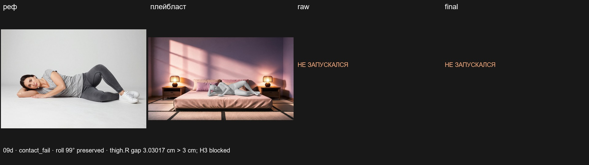
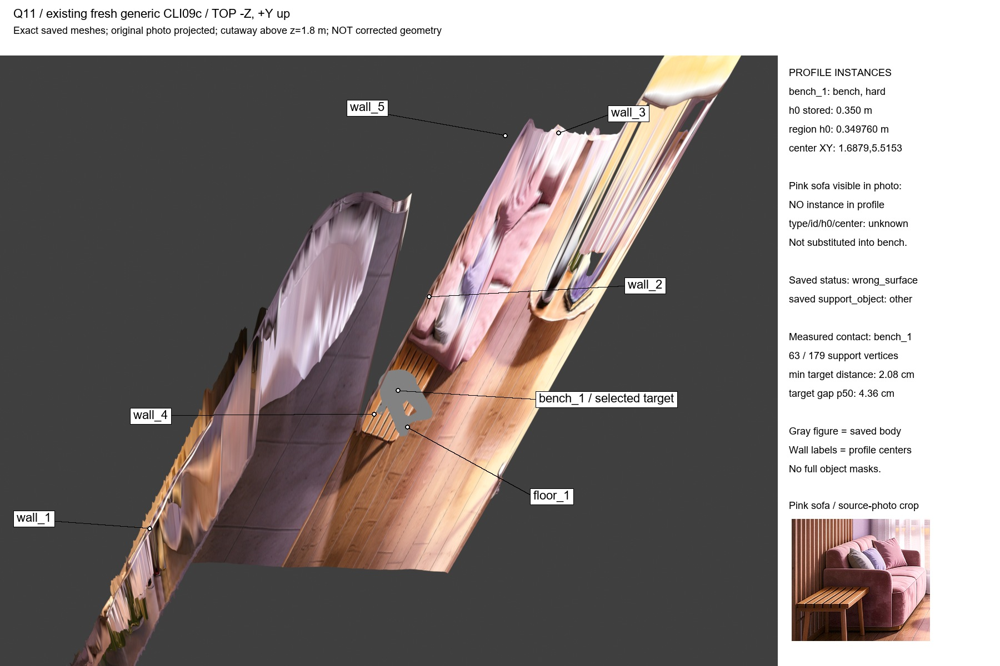
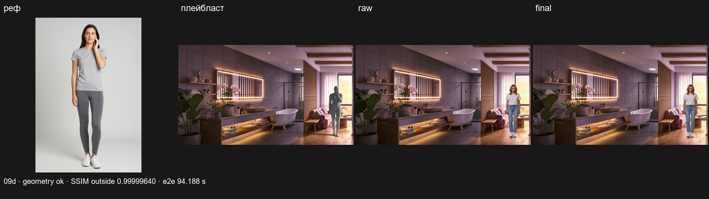

# 3D-A — 09.11d: ручной тест ПК → H3 сервер

По [заданию координатора](../coord/3DA_COMFY_PACK_2026-11-09d.md). Исходное задание первым коммитом **e16da79**, pull --rebase + push выполнены до реализации. Только SFW. Геометрия — RTX3060Ti ПК, H3 — существующий сервер RTX5090. На сервере ничего не устанавливалось. CONTRACTS v0.16 фиксирует именно решение координатора, архитектурных замен нет.

## 1. Lie

Убраны clamp/roll-validation для lie во всех стадиях orient/height/root/refine; прочие восемь классов сохраняют ±15°. Ось таз→шея остаётся в диапазоне YAML75–105° от вертикали (≤15° к плоскости верха). Lie не проходит sign-flip кандидаты: yaw/сторона сохраняются прежним solver; полный крен различает спину0°, бок±90°, живот180°, а не прежний arcsin с потерей половины диапазона. После rigid/refine восстанавливается исходный крен, без orient_clamped. Порогов не ослабляли.

Синтетические5 тестов: полный signed roll, assemble после25° наклона, post-refine, root restore, **реальный place()** на плоской синтетической поверхности (±90° и0°). Вместе с прежними roll/height-регрессиями passed.

Реальный generic CLI Q04: **contact_fail**, target/support=bed_1, roll **99→99°**, tilt81.7→85.9°, сторона front→front, orient_clamped отсутствует. Визуально просмотрены реф и плейбласт: **на боку, голова на согнутой руке, не четвереньки**. Это визуальная приёмка позы, не отмена красного контакта: thigh.R gap **3.0301709568см >3см**, excess0.0301709568см. H3 этому статусу запрещён.

Время: reference(cache)0.047с, placement+load/refine173.453с, Blender7.797с, maps0.547с, total183.922с. Было на том же generic Q04 placement375.390с →173.453с; это результат изменения ориентации/хода попыток, **не SDF-ускорение**, цель≤60с для Q04 не достигнута.

Колонки ref|playblast|raw|final; последние две явно «НЕ ЗАПУСКАЛСЯ». PNG для метрик отсутствуют, SSIM не выдуман. [Компактные факты](3DA_MANUAL_2026-11-09d.json). Полные локальные артефакты: farm/pack_manual_09c/Q04_place_result_09d.json, job d4df6e9bc5f44738a748e638659b34fe.

## 2. Q11 — только диагностика

Полный [отчёт с top10 и Q11](3DA_PROFILE_2026-11-09d.md), [JSON](3DA_PROFILE_2026-11-09d.json). Исследован fresh generic CLI09c job1fab1f1ed9484a97b29dc796e0fc6a36, **не старый V2 fit**; SHA256 до/после совпадают.

- Все bench: **один bench_1**, type bench/hard, h0=.350м (region .349760м), центр XYZ[1.687865169,5.515280899,.350613720]. Розовый диван **не зарегистрирован в objects**, поэтому его type/id/h0/center неизвестны; не называли его bench/other по догадке.
- Выбор2a: hint пуст, **len(candidates)==1 → candidates[0]**. Nearest-anchor/substitutes не применялись; sit_edge_side — последующий выбор стороны, не instance.
- Над верхом bench: pelvis vertices min/median +2.730/+12.426см, foot.L −4.201/+0.302см, foot.R −31.599/−27.921см; hip-midpoint pelvis +12.789839см (не contact skin).
- Saved wrong_surface/support_object=other; pelvis контактирует bench_1, thigh.R=other. Реально под опорой ray-to-mesh:161/179 hits на mesh лавки,18/179 на floor. Не на диване; **other не ID дивана**. Hard bench p95=4.073см, hull fraction.7263. Статус и геометрия не менялись.

Ортографическая −Z, +Y вверх; срез выше z1.8м подписан, исходный mesh/OBJ неизменны. Центры7 существующих instances подписаны; нет выдуманной sofa-сегментации.

## 3. Профиль скорости

Один Q01 cProfile, supervisor600с, exit0. Pstats farm/diagnostics_09d/Q01_before_SDF.pstats; source/config SHA256 start/end совпали. **Top10 cumtime — в [отчёте](3DA_PROFILE_2026-11-09d.md#топ10-по-cumtime-весь-сохранённый-cprofile)**. Участок load_ctx+place wall21.219с, place4.430с; geometry hotspot **pose_fit.ref_planes3.593с =81.1% place**. Непересекающийся penetration envelope.418с=9.44%place/1.97%wall. Поэтому по условию задания **SDF НЕ делаем, другое горячее место НЕ меняем**. Эквивалентность Q01/Q03/T02 после SDF неприменима; T02 baseline был STALE.

Refine контекст реально загружен, но Q01 первая rigid fit ok → refine_mem не вызван. Нельзя объявлять375→21с: прежние375с — другой Q04 с refine. Generic Q01 и runner-профиль имеют разные reference cache; raw профилирование имеет оговорённую аномалию import/enclosing cumtime, данные не правились. Общий SLA≤60с для всех поз не подтверждён.

## 4. H3 Remote / ПК-пульт

Вложенный MIT-пак comfyui/ComfyUI-3DA:3 тонкие ноды Location/Place Pose/H3 Remote. Remote переиспользует farm/comfy_client.py, URL в YAML, Basic auth только env. Пять PNG upload в3da_manual с уникальными именами; заполнение API по title, один submit, history poll, view final/raw. Карта через ImageToMask/red, не инверсия alpha. Финал core ImageCompositeMasked в серверном графе; сырой H3 отдельно. info содержит время/prompt_id, ошибки дают status=error+safe response и чёрные64px заглушки, граф не падает. Rejected PlacePose возвращает пустой prompt; Remote отсекает его до upload. Ручное дополнение не должно обходить этот guard.

PC UI/API заменяет H3-движок Remote; editable String переведён на **core StringConcatenate**: на ПК CustomScripts отсутствует. Серверные API/UI сохраняют existing H3 recipe и серверный pysssss String, LoadImage для5 входов. Серверный object_info HTTP200: types/required inputs/links/models проверены; установка не нужна. Файлы: workflows/3DA_manual_v1.json (+.api.json), 3DA_h3_server_api.json, 3DA_h3_server_v1.json; builder и link/roundtrip тесты обновлены.

Установленный пак ПК обновлён с backup вне custom_nodes, local config сохранён. Реальный запуск выявил отсутствующий HTTPX в env ComfyUI (в farm env он был); с отдельного разрешения пользователя установлен HTTPX0.28.1/httpcore1.0.9 **только на ПК**, requirements/pyproject исправлены. BSD-3-Clause, новых NC нет. Q01 stand не имел floor-якоря: с разрешения пользователя в local config добавлен явный seed[2.0985318007,4.5587387135,.0008802823] из проверенного Q01, не угадывание/VLM. Рестарт нашего PID2980 разрешён отдельно: error-output ComfyUI был закэширован. Три локальных неуспеха сохранены, серверных submissions в них не было.

## 5. Q01 end-to-end (реальный API ПК)

**PASS**, локальный prompt_id824b4983-ca2d-46fb-9331-80e0f54d949b, server prompt_id73c3ddc2-9fcb-4b54-9be0-2f6fb66f0b5b. Это **один полный запрос**, геометрия в нём реально пересчитана: для проверки не использован Comfy-кэш Place (уникальные LoadImage names, тот же PNG SHA/SAM cache). Seed101.

| Этап | Время, с |
|---|---:|
| Reference cache |0.047|
| Placement+model context |8.797|
| Blender |6.547|
| Maps |0.547|
| Generic geometry total / node total |17.782 /18.500|
| Remote upload |4.047|
| Server queue+H3 (включает ожидание) |68.157|
| Remote total |73.875|
| **ПК API полный wall** |**94.188**|

SSIM вне карты к plate PNG **0.9999963963 ≥0.995**, outside955941px, **0 изменённых пикселей**. Метрика по PNG, JPEG только доказательство. Предыдущий smoke Remote169.312с с cached geometry сохранён отдельно, **не выдаётся за полный94.188с запуск**.

Глазами: background сохранён, на месте манекена человек в SFW-футболке/джинсах; H3 опустил руку вместо руки у лица — **SSIM фона не является приёмкой позы/личности**, дополнительных метрик вне задания не вводили. FullHD/видеопетля не запускались, это1344×768 still.

Для запуска одной кнопкой готов Q01 preset **на ПК** C:/work/ComfyUI-next/user/default/workflows/3DA_manual_v1.json: входы реально загружены, stand/floor/body.json/seed настроены. Копия и серверный manual workflow в C:/Users/user/Downloads/3DA_COMFY_PACK_2026-11-09d/. Tracked JSON остаётся переносимым шаблоном без конкретных локальных upload имён. Во фронтенде браузера кнопка не нажималась: проверено реальным API тем же графом.

### Q04 через тот же API ПК

Реальный local prompt_id **af8b60b0-36ec-4d43-9d7d-c18bf304b635**, wall **244.328с**; reference13.985с, placement196.484с, Blender27.468с, maps.610с, generic total240.453с. Этот запуск пересёкся с завершающим рендером batch17, поэтому его время не является изолированным benchmark. Статус **contact_fail**, roll99→99°, тот же thigh.R gap3.0301751см. **Remote info=error: Empty H3 prompt**, до upload/submit; H3 prompt_id отсутствует. Граф не упал, отдал диагностические превью;64px чёрные raw/final — заглушки, не H3-изображения. SSIM неприменим. Guard подтверждён не только mock, но реальным API ПК.

## 6. Перепрогон17

В фоне tools/scene3d/rerun_17_09d.py: backup V2_before_09d_20261109_144847, placement1800с wall с kill дерева; затем render только завершённых новых body. NEW определяется по фактическому fit mtime, старые не выдаются за новые. Фактический **timeout exit124,1800.188с**: **14 NEW/17**, из них12ok/0partial/2contact_fail (**Q10,T01**). **T03,T04,T05 STALE**, сохранены прежние partial/ok/ok без выдачи за новый результат. Рендер14 завершённых — exit0, каждый новый body реально отрендерен локально. [JSON](3DA_RERUN_2026-11-09d.json), [лист](img/poses_v26.jpg) просмотрен глазами; копия Downloads. Batch Q04=ok/roll99°, Q11=ok **не подменяют** generic ручные contact_fail/wrong_surface: у runner другой ShotSpec/seed (у Q04 support только pelvis, у generic pelvis+torso+thigh.L/R). Ошибки Q11 не исправлялись, старые17-настройки не менялись.

## 7. Тесты / ограничения

- Полный geometry unittest: **82 OK**,940.003с; финальная повторная проверка lie5 и прежние roll/height17 OK (перекрываются с82, не складываются).
- Pack/Remote/UI/CLI/H3/report/gate: **84 passed +13 subtests**,7.73с.
- Latent CPU entrypoint test_latent.py: **5 OK**,.043с. Pytest package-collection этого внешнего пакета не подходит (comfy stub создаётся самим test_latent, package __init__ раньше него требует comfy); прямой штатный entrypoint passed.
- Итого **171 уникальный тест OK**, subtests отдельно. Первый pytest вызов содержал неверное имя отсутствующего test_pose_proxy_v26.py,0 tests; исправленный набор выше passed. git diff --check выполнен.

Не сделано: Q04 H3/SSIM/final (contact_fail, правило не обходим), исправление Q11 вне объёма, SDF неприменим по профилю, ускорение иного hotspot не разрешено, все-позный SLA60с не достигнут; sofa metadata и legacy full footprints неизвестны. Загрузка/установка на сервер, VLM, Character Prep и сегментация не выполнялись. Требуются только решения координатора по остаточным геометрическим ошибкам, не ослабление порогов исполнителем. Фоновых geometry/Blender/CLI задач после финиша нет; API ПК оставлен запущенным для ручного теста, локальная очередь пуста. Наши два завершённых H3 prompt_id в серверной очереди отсутствуют; при финальной проверке на сервере были1running/1pending **других** запросов, их не останавливали и /free не отправляли. Тяжёлых своих работ не оставлено.
