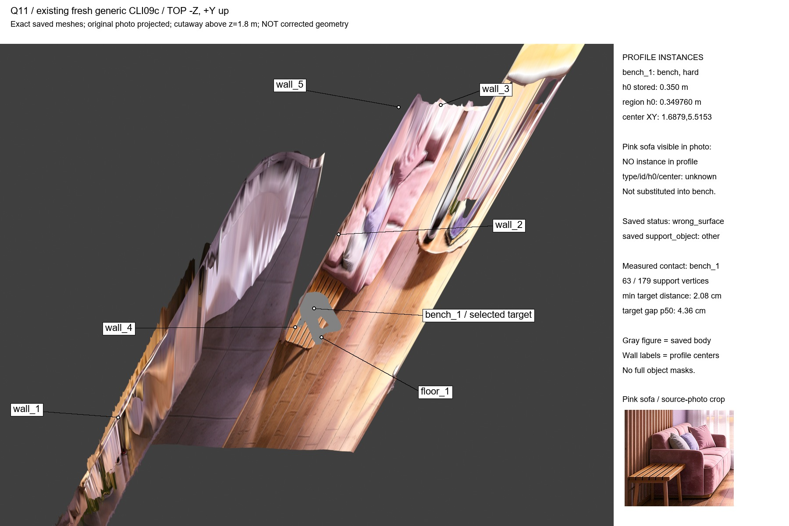

# 3D-A 09.11d — факты: один профиль Q01 и saved Q11

Только пункты 2, 3 задания координатора: один реальный `place()` Q01 до SDF; read-only диагностика **fresh generic CLI09c** Q11. Исходный код geometry/pack/workflow, состояние Q11 и пороги не менялись. Новые зависимости не устанавливались, сервер не использовался, commit/push не выполнялись. SDF не реализован. Только SFW.

Машиночитаемые факты, полные SHA256 исходников/config до/после, p95 и топы: [3DA_PROFILE_2026-11-09d.json](3DA_PROFILE_2026-11-09d.json).

## 1. Q01: один cProfile, без повторов

- HEAD при профиле: `e16da79914c18d966896d404625ae0324050e59c` (`e16da79`). Хеши всех прочитанных geometry sources и `config/placement.yaml`, installed `config.yaml` сохранены; start/end совпадают. Параллельные изменения координатора lie не подменяются этим HEAD: именно содержимое файлов закреплено SHA256.
- Installed config: `C:/work/ComfyUI-next/custom_nodes/ComfyUI-3DA/config.yaml`; из него `farm_root=C:/work/scene3d_work/farm`, `geometry_python=C:/work/ComfyUI-next/venv/Scripts/python.exe`, mainroom1 assets=`C:/work/scene3d_work/plate/mainroom1`.
- Команда из корня repo: `.venv/Scripts/python.exe -I tools/scene3d/diagnose_09d.py profile`. Supervisor запускает isolated geometry worker, `wait(timeout=600)`, при timeout — `taskkill /T /F`. Запуск был background, exit0; timeout не потребовался. Один вызов `place`, не benchmark-loop.
- Raw pstats: `C:/work/scene3d_work/farm/diagnostics_09d/Q01_before_SDF.pstats`; факты/хеши/лог рядом: `Q01_profile.json`, `Q01_sources_start.json`, `Q01_profile.log`, `Q01_process.json`, `Q01_exit.json`.
- Reference **runner cached**, не fresh generic SAM cache: `C:/work/scene3d_work/refs_v2_npz/Q01_stand_hand_face.ref.npz`; contains SAM mesh/joints и `mhr_*`. ShotSpec из `farm/pose_round/V2/Q01_stand_hand_face/shot_spec.json`; body dims из `farm/characters/stacy/body.json`, source=`profile`, height1.62м. Geometry cache=`farm/characters/stacy/geometry_cache`. RNG101. Seed мира из runner table feet: `[2.0985318007, 4.5587387135, 0.0008802823]`.
- **Реальная постановка `ok`**: первая rigid fit прошла, target/support=`floor_1`; soft/hard p95 **0/0м**. Новый fit в V2 не записывался, старые результаты не перезаписаны.
- `refine_ctx` доступен: SAM3DBody loader успешно отработал; исключения из `load_ctx` не подавляются. **`refine_mem` не вызван**: `place.py:1044–1046` выходит на первой `ok` rigid fit до ветки refine. Это не случай «refine отключён».
- Wall для profiled участка `load_ctx + place`: **21.219с**. `place` cumtime **4.430с**; `prepare_body`3.620с → `pose_fit.ref_planes`3.593с, self3.183с (**81.1% place по cumtime**). Главный geometry hotspot — RANSAC плоскостей сцены референса, не point-mesh.

### Топ10 по cumtime, весь сохранённый cProfile

| Функция / файл | Calls | Cumtime, с |
|---|---:|---:|
| `<module>` — ComfyUI `comfy/lora.py:1` |1|5.072407|
| `<module>` — `comfy/model_base.py:1` |1|5.050456|
| `place` — `posev2/place.py:839` |1|4.430261|
| `<module>` — `comfy/ldm/hidream_o1/model.py:1` |1|4.277552|
| `<module>` — `comfy/text_encoders/qwen35.py:1` |1|4.272634|
| `<module>` — `comfy/sd1_clip.py:1` |1|4.267539|
| `_register_to_dispatcher` — torch custom_ops.py:607 |140|3.830053|
| `<module>` — transformers/__init__.py:1 |1|3.640217|
| `prepare_body` — `posev2/place.py:86` |1|3.620465|
| `ref_planes` — `posev2/pose_fit.py:204` |1|3.593307|

Дополнительный top10 только функций farm сохранён в JSON. Cumtime вложенных функций **не складывается**.

### Point-mesh / penetration: конкретные функции, без двойного счёта

- `place.penetration_values`:5 calls, cum0.381071с, self0.371947с; включает5 вызовов `pose_fit.penetration`.
- `place.penetration_stats`:4 calls, cum0.322909с — обёртка над предыдущей; отдельно к ней **не прибавляем**.
- `pose_fit.penetration`:129 calls, cum0.040331с, self0.020707с. Из них124 вызова из rigid residuals — cum0.037227с; остальные5 уже входят в penetration_values.
- Disjoint penetration envelope: **0.418298с =9.44% `place` /1.97% profiled wall**. Чистый `pose_fit.penetration` —0.91% `place`.
- Существующая проверка — camera-depth candidate filter → `cKDTree.query` ближайшей **точки** поверхности → dot normal, не точное point-triangle mesh distance (`pose_fit.py:187–200`). Произвольную долю всех KDTree-запросов нельзя объявлять penetration: они применяются и для контактов.
- Вывод отправлен координатору **сразу по готовности pstats**; решение координатора: **SDF не делать**.

Ограничение cProfile: raw `total_tt=23.769с` превышает wall21.219с; enclosing frames `load_ctx/load_head` отсутствуют, хотя loader.execute присутствует и контекст получен. Импорт/регистрация runtime могли повлиять на enclosing frames. Поэтому импортные cumtime не суммируются и не выдаются за независимые этапы. Raw pstats сохранён без правок; один прогон не перезапускался.

### Почему это не доказательство «375с →21с»

Generic Q04/Q11 из09c использовали **другие позы**, fresh SHA256 SAM cache и неуспешные rigid attempts с MHR refine (у Q11 сохранён refine200 iterations/30с для выбранной попытки; весь placement367.312с). Эта Q01 использует уже существующий runner ref, а первая rigid fit сразу `ok`, поэтому refine отсутствует. Профиль не включает MoGe/SAM reference extraction, создание Plate до profiled участка, Blender, maps или H3. **Generic Q01 не профилировался**, общий SLA≤60с на произвольной позе не подтверждён;6мин этой Q01 не воспроизведены. Новых профилей/лишних Q03,T02 прогонов не делалось.

## 2. Baseline p95 для возможного сравнения (без SDF/новых прогонов)

| Поза | Источник baseline | Status | Soft p95, м | Hard p95, м | Актуальность |
|---|---|---|---:|---:|---|
|Q01|единственная постановка этого профиля|ok|0|0|fresh09d, до SDF|
|Q03|существующий `V2/Q03_bed_kneel/fit.json`, fit_hash=e3373a41a1b8ed2d|ok|0.02113409709490807|0|последний завершённый09c2ae|
|T02|существующий `V2/T02_kneel_lunge/fit.json`, fit_hash=7e2fbc616b73b5d9|ok|0|0.016082496316072045|**STALE: не перепрогнан09c2ae, актуального baseline нового2ae нет**|

Координатор параллельно начал свой batch17 после нашего профиля. Чтобы его новые fit не подменили baseline, Q03/T02 прочитаны из сделанного им snapshot `C:/work/scene3d_work/farm/pose_round/V2_before_09d_20261109_144847/{id}/fit.json`. Полный penetration block, sha256/mtime/path в JSON. Свой backup/placement17 не запускался. T02 stale не аттестуется как current; эквивалентность SDF не измерялась.

## 3. Q11: existing fresh generic CLI09c, только чтение

Не старый `pose_round/V2/Q11`!

- Запрос: `C:/work/scene3d_work/farm/pack_manual_09c/Q11_bench_side_sit_request.json`.
- Результат: `.../pack_manual_09c/Q11_place_result_after_fixes.json`.
- Точный fit/body/joints: `C:/work/scene3d_work/farm/pack/jobs/1fab1f1ed9484a97b29dc796e0fc6a36/fit/`.
- Fresh SHA256 reference: `C:/work/scene3d_work/farm/cache/pose_ref/a823ac92e73602697a5fd5009398c9a8d410d2fca2887fd7ce033e7d99669498/pose.ref.npz`.
- JSON/NPZ/OBJ профиля и результата прочитаны, не менялись; SHA256 before/after равны. Top-view использует те же OBJ, без place/refine.

### Все bench и розовый диван

| ID | Type | h0 профиля, м | Центр верхней сетки XYZ, м |
|---|---|---:|---|
|bench_1|bench, hard|0.350|[1.687865169,5.515280899,0.350613720]|

**Других bench нет. Розовый диван виден на фото, но не зарегистрирован в `objects` вообще**: нет sofa, armchair или other instance. Профиль содержит ровно bench_1, floor_1 и wall_1…wall_5. Поэтому тип/id/h0/центр дивана **не определены**, не выдуманы; его не выбирали как замену bench. Известные центры всех7 объектов сохранены в JSON и подписаны на top-view. У bench region точный `h0=0.349760м` (profile JSON округляет до0.350).

### Точная ветка правила2a

`profiles.LocationProfile.find_object`, `profiles.py:86–93`: первый kind=`bench`; найден **один** candidate; instance_hint пуст → `len(candidates)==1` → `return candidates[0], kind`. Выбран **bench_1**. Ветка nearest-anchor `94–100` и substitutes **не достигнуты**. `pack_cli.seed_for` берёт средние XY/h сохранённого anchor zone `bench_1_edge`; затем resolve_regions выбирает тот же единственный instance. Сохранённая zone.rule=`sit_edge_side`, это выбор стороны/ячейки **после выбора instance**, не причина выбора между экземплярами.

### Высоты таза и стоп относительно верха bench_1

Все высоты ниже относительно точного region h0=0.349760м. Part labels — существующие `body.regions` по topology ref, не новая сегментация.

| Часть | Min вершин, см над h0 | Median вершин, см над h0 |
|---|---:|---:|
|pelvis|+2.730|+12.426|
|foot.L|−4.201|+0.302|
|foot.R|−31.599|−27.921|

SAM pelvis (середина hip joints): Z0.477658393м = **+12.789839см**. Left heel +1.723940см, left big-toe +1.491119см, left small-toe −2.822300см; right heel −23.987061см, right toes примерно−30.3см. Полный набор joint XYZ/ankle/heel/toes в JSON. Joint высота таза — не зазор контактной кожи: её нельзя сравнивать напрямую с3см.

### Фактическая опора и поверхность под ней

- Сохранено **wrong_surface**, support_object=`other`; `support_parts_on={pelvis:bench_1, thigh.R:other}`. Валидатор first_failure=`support_target`; статус не менялся.
- Existing `geometry_diagnostics` измеряет179 selected-support vertices:63 имеют близкий контакт с **bench_1**, min3D distance2.076767см; target normal gap min2.000462см, p50 **4.358см**. То есть «есть некоторые контакты bench» **не равно** «все группы валидно на bench»; `other` не является ID дивана.
- Дополнительно точные вертикальные rays по **существующему plate_mesh** из этих179 вершин:179 hits; **161 на высоте bench0.30–0.40м,18 на высоте пола ±0.04м**. Hit Z min/median/max=−0.008800/0.353519/0.357915м; вертикальный gap min/median/max=0.020008/0.044979/0.451870м. Реальная поверхность под основной опорой — mesh лавки; часть опорных точек нависает над floor. Это не доказывает опору на диван, чей instance в профиле отсутствует.
- Saved hard:bench_1 p95=0.04073336902714569м>0.03м. Read-only recompute по OBJ с5 decimals=0.04073375178983095м (округление mesh); не заменяет saved baseline. Support hull inside fraction0.726297.
- D4 по-прежнему blocked: полного footprint/object-mask у bench нет. Верхняя grid mask не объявляется full object extent. Никакие исправления не вносились.

## 4. Top-view с подписями

`C:/work/ComfyUI-Farm/docs/experiments/img/Q11_top_09d.jpg`; копия `C:/Users/user/Downloads/3DA_PROFILE_2026-11-09d/Q11_top_09d.jpg`.

Existing `render_plate_scene.import_plate/setup_plate_camera`; исходные `plate_mesh.obj` и saved `body.obj`, фото спроецировано на тот же mesh через исходную camera projection. **Ортографическая камера строго сверху −Z, +Y вверх**, `[1.6,5.8,12]`, scale7.4м; camera near clipping даёт срез выше Z1.8м, mesh на диске не меняется. Blender5 EEVEE; освещение не используется как геометрическое доказательство. Лейблы привязаны к вычисленным world-centers профиля, не поставлены «на глаз». Розовый диван идентифицирован дополнительным crop исходного фото, без выдуманного центра/instance. Рельеф из одного фото закономерно растянут и имеет дыры/самоокклюзии — это ограничение существующего mesh, не дорисовка комнаты. Top-view просмотрен глазами, подписи не перекрывают ключевую лавку/тело.

Raw render/projection/ray hits лежат только в локальном `farm/diagnostics_09d/`. Для воспроизведения: geometry env `diagnose_09d.py q11`; Blender `-b --factory-startup --python-exit-code 1 --python tools/scene3d/diagnose_09d.py -- q11-top`, с прежними FARM_BPY_PKGS/SCENE3D_BLENDER_SITE; farm env `diagnose_09d.py report`. Никаких пакетов/моделей не добавлено; новые лицензионные ограничения не возникли.

## Итог / ограничения

Сбор фактов завершён. Главный hotspot Q01 — ref_planes, поэтому по решению координатора SDF не делается. Нельзя объяснить generic375с этим rigid-only профилем или объявить speedup. Актуальный T02 baseline после09c2ae отсутствует; дополнительного прогона нет. Диван не размечен в профиле, его id/type/h0/центр неизвестны. Q11 сохранён rejected, геометрия не исправлялась. Других задач/GPU-прогонов/серверных действий нет; STATUS/общий09d отчёт не менялись.
