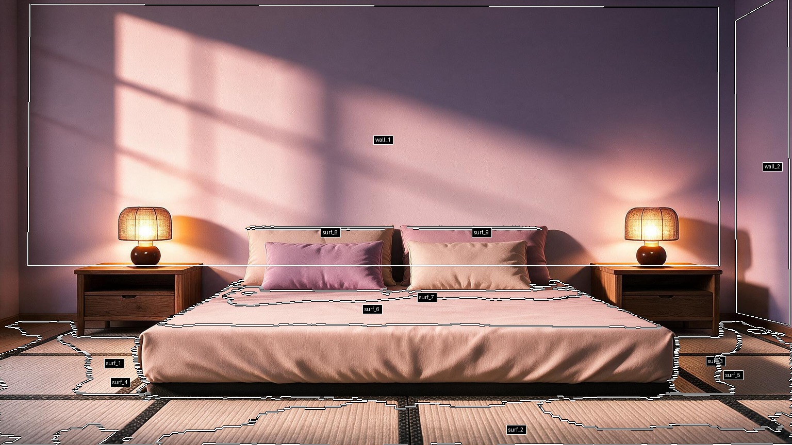
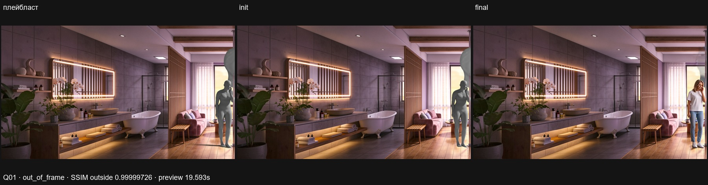
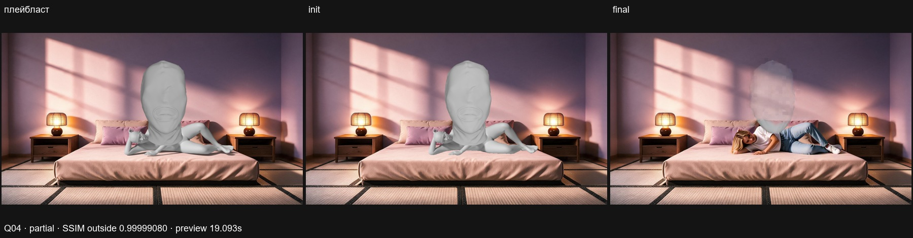

# 3D-A — 09.11e: ручной режим, трансформ тела и предмет

По [заданию координатора](../coord/3DA_PROPS_2026-11-09e.md), сохранённому и pushed первым коммитом **0a9eb3a**. Исходный HEAD09e9dd4. Пользователь сообщил props_source_dir=C:/Users/user/Downloads/3d_objects. Только SFW; кости не менялись; на H3-сервер ничего не устанавливалось. Правила обновлены в CONTRACTS v0.17.

## 0. Ручной режим / контакты / скорость

- PlacePose `block_on_fail=False` по умолчанию: status/flags сохраняются, prompt не отсекается для out_of_frame/wrong_surface/contact_fail. `True` возвращает прежний статусный guard ok|partial. Реальная ошибка без геометрии остаётся error+placeholder; «всегда» не означает выдумать отсутствующий mesh.
- Единый контакт всех классов — хотя бы одна вершина declared support_parts в ±contact_tol. В rep.support_contact: контактное число, gap_parts, part_gaps_m, max_support_gap_m. Gap>contact_tol → support_gap; >5см →partial. Существующий смысл зазора части — median signed distance low-band (сохранён, не заменён max отдельной вершины). Остальные проверки не удалены: wrong_surface/out_of_frame сохраняются; penetration/orient/footprint/cells/refine ошибки →partial+именованные flags/checks, а не новый enum/contact_fail без основания.
- Generic Q04 действительно перепоставлен: **partial**, support_gap, max gap22.386см на поднятом thigh.L (ранее generic default включал обе thigh). Контакт38 вершин есть; lie99° сохранён. Первый новый generic placement52.641с,total65.344с; props запуск45.187с,total59.672с. Поздний cold run48.782с,total65.375с. Отличия wall под параллельными проверками не объявляются строгим benchmark. Исторический placement173с не воспроизводится после нового правила; цель≤60с достигнута для этих placement-участков, **не гарантирована для всех полных прогонов**.
- Runner Q04/Q10/T01 и T03–T05 повторно выполнены; полный актуальный17-лист и итог добавлены ниже. Generic и runner ShotSpec различаются, статусы не подменяют друг друга.
- ref_planes: vectorized numpy RANSAC scores при прежнем RNG/tie-first; placement-local content memo, сбрасывается на exit/exception. **Эквивалентность Q01/Q03/Q04/T02: X/KP/planes max delta0 ≤1e-6**, penetration/status совпадают при одинаковом новом контактном правиле. [Отчёт](3DA_CONTACT_SPEED_2026-11-09e.md), [JSON](3DA_CONTACT_SPEED_2026-11-09e.json). Один after CPU профиль Q01: place3.1276с, ref_planes2.2111с=**70.6971%**. Memo вызов1 на реальном place, не фиктивное ускорение по hit. CPU Q03 всё ещё511с — общий SLA≤60с не подтверждён.
- `pose_text` optional добавляется одним предложением в detailed_description; props — по предложению description_en/name + floats motionless in the air + форма/цвет/материал init. Existing H3 lint обязателен; секции и multi-line injection запрещены. Для Q01/Q04 использованы SFW pose sentences, static camera/light/color constraints прежние.

## Авто-поверхности новой комнаты

Новый auto_surfaces module: height_proxy2см, бины2см,4-связные области≥.15м², surf_N с h0/area/center/seed_world; стены existing RANSAC. Никакой семантики bed/soft/scale не придумывается. ID поддерживается через find_object и нормализуется в ShotSpec type+instance_hint; конфликт explicit ID/hint — error.

Тест существующего mainroom3 **в новой отдельной папке**: **9 surf_N +2 wall_N**, CPU3.65с,224 мелких компоненты исключены. Самая большая surf_6:1.4556м²/h.3125м, самая низкая surf_1:.3808м²/h−.004м — разные. Поэтому **floor_ambiguous**, floor_1 не присвоен. Placement для ambiguous auto profile останавливается до legacy floor fallback, не выдаёт guessed floor. Автоповерхности/preview работают, но размещение в этой автоматически подготовленной комнате требует явной подготовки пола/scale prompt context. Existing location profiles не изменены.

Location append objects_preview IMAGE slot3, прежние slots0–2 сохранены; контуры реальных ячеек/дыр и ID. Preview existing profiles пишет только в cache, сами profile/npz не меняются. Test profile/npz только локально C:/work/scene3d_work/auto_surfaces_09e_test_20261109/profile/.

## 1. Ручной трансформ тела / кэш

body_dx/dy/dz — horizontal camera-right/depth/up, dyaw/dpitch/droll вокруг центра таза. После base place — rigid transform всех vertices/KP и полный evaluate/validate без автоматической повторной посадки/clamp/lift. Масштаб черезheight_m. Никаких bone operations.

Content key включает reference bytes, profile/top grids/walls, location geometry, config placement, geometry sources, ShotSpec,height/body/seed. **Не включает body_* и props**. Кэш — full precision NPZ+report, не округлённый OBJ. Изменения только предмета/тела используют base, SAM/place/refine повторно не запускаются; остаются Plate load, validator, renderer, maps. Ключ учитывает seed (исправлено до финального warm test); первые повторные запуски после изменения исходников имели ожидаемый cache miss.

Warm preview:
- Q01 dx+.3м/dyaw20°, cache_hit=true, placement/validate .562с, render10.422с, props/maps5.781с,total **19.593с**;
- Q04 cache_hit=true,placement .188с,render10.141с,props/maps5.859с,total **19.093с**.

Реальное edit-only доказательство (отдельно от финального заданного теста): Q01 body_dx.30→.31м и prop yaw0→5°, **placement_cache_hit=true**,placement/validator.625с,total20.937с; H3 не запускался. Это не только повтор неизменного запроса, SAM/place не вызваны.

**Цель15с не достигнута**. Рендер двухэтапный: existing body pass затем prop overlay. Не заменяли его иной архитектурой ради тайминга. Реальная цепочка **3DA Prop→3DA PlacePose через API ПК8187** с Remote отсутствующим в графе прошла: local prompt cde9066e-f297-4bb0-a022-21e9b2b3dec9,partial,wall84.094с (cold source-key,placement59.047с,geometry+render78.828с); H3 не вызывался.

## 2–4. Библиотека / Prop / композит

[Подробный импорт и gizmo-ресёрч](3DA_PROPS_LIBRARY_2026-11-09e.md), [JSON](3DA_PROPS_LIBRARY_2026-11-09e.json). Импортирован **1 FBX → normalized GLB**, head_close_a648e192; остальные источники не импортировались/визуально не проверялись. Исходная голова25974vertices/51944triangles, bbox.5733×.7494×.9769м. `scale=1` сохранён буквально: **почти метровая голова**, не уменьшалась самовольно. Source texture file1 отсутствует; материал сохранён, неизвестную текстуру не восстанавливали. LICENSE нет: **unknown, локальный тест не даёт разрешения для прода**. Бинарники вне публичного repo в FARM_ROOT/props.

Import pipeline безопасно читает пользовательские assets: trusted scripts/cwd, Python-I, Blender factory-startup/disable-autoexec, только static formatsFBX/OBJ/glTF/GLB, units→meters,bbox-center origin,materials/UV, normalized cache. OBJ единицы не содержит — документировано предположение метров. Никакой код из Downloads не исполнялся.

3DAProp JSON-only с chain, library combo, anchors world(pelvis)/head/chest/hands/pelvis, XYZ/yaw/pitch/roll/scale/strength; schema/finite/path проверяются. Prop strength UI .35, если metadata другой — ручное значение (без frontend скрытого sentinel). Диагностика room/body — AABB с возможными false positives; out_of_frame — projected bbox, не exact triangle collision. Flags advisory, не опора.

Рендер: playblast clay prop, init исходный prop material, occlusion комнаты/тела через holdout; per-prop visible mask. Strength max(body,prop_strength×тот же compact16px dilation32px edge). Mask8bit как прежний pipeline. White clipping первого preview исправлено нейтральным AgX-light, размер/поворот не менялись. Нет текстуры — clay/textured оба серые, не claim полноценного textured asset.

## 6. Проверка с H3 Remote

Сначала фактические preview CLI, затем фактический **H3 Remote через API ПК8188** с этими PNG и готовым prompt; обновлённые Prop/PlacePose дополнительно проверены на отдельном API8187. Не выдаём split preview+remote за один полноразмерный one-click graph cold benchmark. Конкретно заданные poses/body offsets и prop scale1 соблюдены.

| Шот | Geometry status | Warm preview | Remote total / queue+H3 | SSIM вне карты | Изменено вне карты |
|---|---|---:|---:|---:|---:|
|Q01+head,body_dx.3/dyaw20|out_of_frame|19.593с|66.485/54.406с|**.9999972644**|**0px**|
|Q04+head|partial|19.093с|62.703/54.531с|**.9999908026**|**0px**|

Q01 flags support_gap,penetration_fail,prop_hits_body/room/out_of_frame. Q04 flags support_gap,dominant_top_unavailable,prop_hits_body/room. Генерации **не заблокированы статусами**. Prompt IDs и этапы в [JSON](3DA_PROPS_MANUAL_2026-11-09e.json). Внешняя SSIM PASS обоих, PNG метрика, JPG только доказательство.

Визуальная приёмка предмета: **нет для обоих**. В Q01 большая голова за правым краем, после H3 не узнаётся; это следует заданным scale1/смещению плюс dx тела, не основание тихо переместить его. В Q04 контур головы остаётся, но предмет полупрозрачен/потерял материал и форму; узнаваемость исходного mesh не принята. При prop_strength.35 финальная общая вклейка смешивает raw с plate — H3/композит не гарантирует сохранение stylized asset. Не подменяем это PASS фона. Следующий рецепт strength/placement/текстуры — решение координатора, новых прогонов вне задания не делали.

## 5. Готовые 3D-гизмо

| Нода | Gizmo TRS | Transform output | Лицензия |
|---|---|---|---|
|Builtin Load3D|да|да,model_3d_info:Y-up position/quaternion/scale|GPL-3.0|
|Builtin Load3DAdvanced|да|да,model_3d_info|GPL-3.0|
|ComfyUI-3D-Pack Preview_3DMesh|нет,OrbitControls камеры|нет,RETURN_TYPES=()|wrapperMIT;модели отдельно|

Проверено по установленному core/frontend source map и первоисточникам; UI руками не тестировался. Новый frontend не писали. Adapter Y-up/quaternion к location axes вне объёма п5 (только отчёт).

## Workflow / запуск

Tracked workflows/3DA_manual_v1.json/API обновлены: Prop **bypass по умолчанию**, body_*,pose_text,block_on_fail,objects/init previews. API bypass эквивалентен отсутствующей Prop-ветке. README объясняет включение Prop/chain и mute Remote+3 consumers для чистого preview; затем вернуть для H3. Server UI изменил только UUID портов сабграфа при builder, семантика не менялась, roundtrip тесты passed; на сервер не устанавливался.

Source скопирован в установленный пак с backup, config geometry сохранён, props_source_dir добавлен. Старый процесс8188 сохранил старые definitions; для новых нод поднят API **8187**. Готов local workflow **3DA_props_Q04_09e.json**, Prop включён, Remote muted для безопасного preview; копия в Downloads/3DA_PROPS_2026-11-09e. Полный reusable template остаётся3DA_manual_v1 с Prop bypass. В браузере интерактивная приёмка не делалась.

## 17 поз / тесты / финиш

**17/17 NEW**: **10ok /5partial /2wrong_surface**, все fits реально пересчитаны в09e. Partial: Q04,Q08,Q09,T01,T03. Wrong_surface: Q12,T05. Q10 теперьok+support_gap. Q04partial+support_gap; T01partial+support_gap+orient_clamped:21.1. T03partial с no_back_contact. Remaining11 supervisor placement exit0, затем общий render17 exit0; каждый shot имеет новый плейбласт, лист просмотрен глазами. [Все статусы/флаги](3DA_RERUN_2026-11-09e.json), [лист](img/poses_v26.jpg), копия Downloads. Настройки Q11 не исправлялись.

Тесты: полный geometry unittest **96 выполнено,95passed/1failed** за896.577с — failing новый тест подменял stale place.CFG после config-test reset, а validate читает текущий section(). Исправлен именно тест: patch текущего section('place'); повторная группа config/contact/manual **27passed**. Дополнительно2 новых cache tests прошли. Совокупно **98 уникальных geometry tests passed** (не один повторный full запуск); полный96 после исправления не повторяли. Pack/CLI/props/H3/report/gate **102passed** (новый prompt/lint test включён), latent directCPU **5passed**. Ещё **18 pytest-only auto-surface/ID tests passed** (.53с), они не обнаруживаются unittest discovery. Итого **223 уникальных теста OK**, subtests отдельно. Финальная пересекающаяся проверка129passed+22subtests за9.67с; повторные наборы в223 не складываются. Ранние5 stale CLI fixtures и obsolete contact assertions обновлены под новые входы/контракты, последующие наборы passed.

Полные profiles/medias/models/секреты в repo не копируются.

Не достигнуто:15с preview,общий60с SLA,визуальная узнаваемость props после H3,текстура head отсутствует,лицензия source неизвестна. Auto-floor ambiguous — стоп размещения без явной подготовки. Никаких платных API, серверных installs,VLM/Character Prep/кручения костей. На финише проверены0 geometry/Blender/pack процессов, очереди ПК8187/8188 и сервера пусты; свои тяжёлые задачи не оставлены. Два ComfyUI API ПК оставлены idle:8187 для новых нод,8188 прежний процесс; остановка чужой/старой сессии не выполнялась. Новых pip-зависимостей не устанавливалось. Артефакты для просмотра скопированы в Downloads/3DA_PROPS_2026-11-09e.
